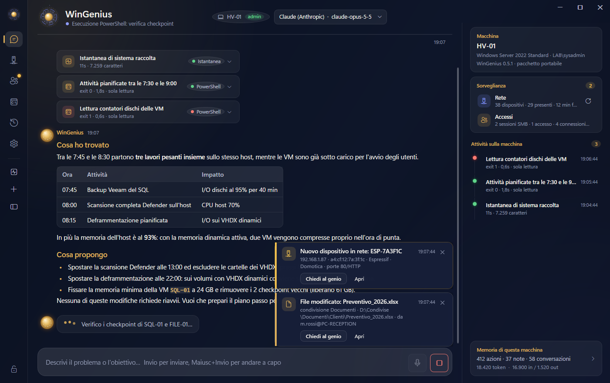
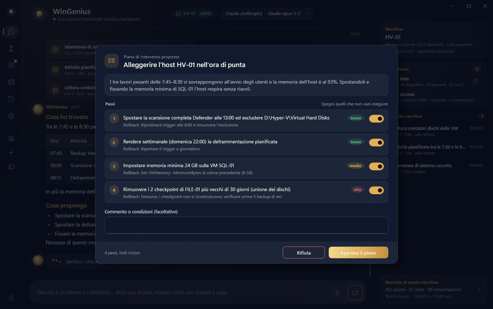
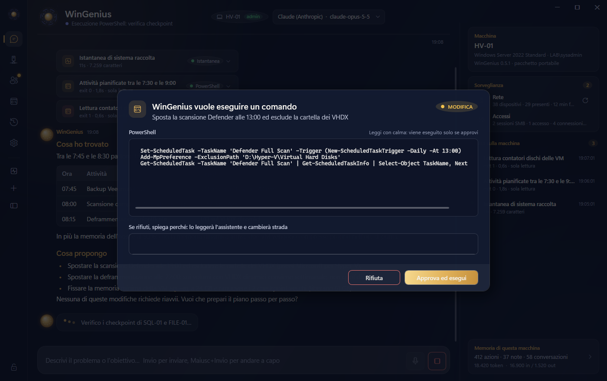
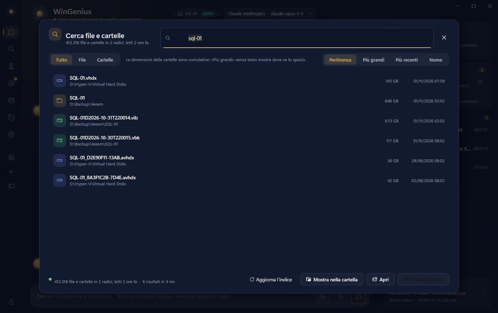
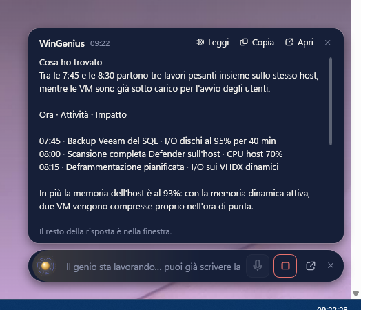
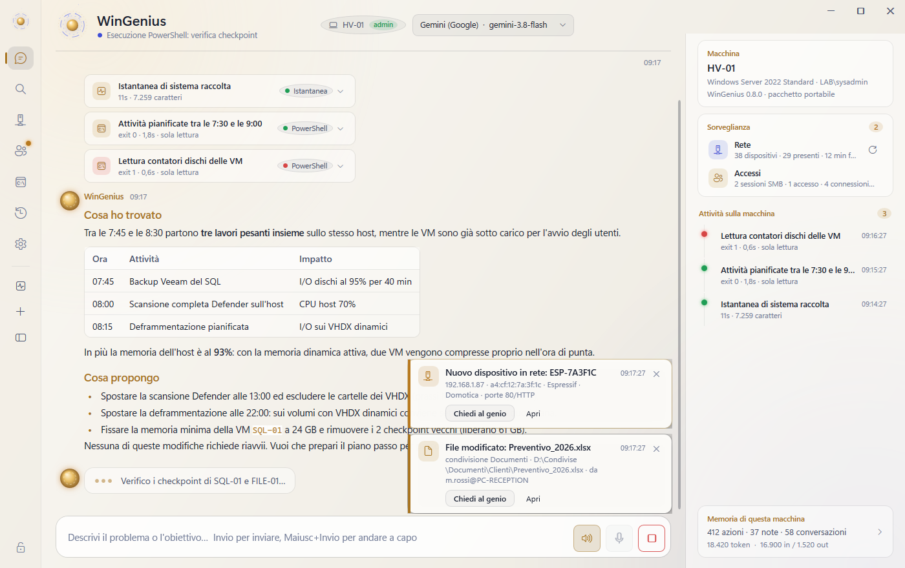

# WinGenius

**L'assistente sistemista con memoria per Windows desktop e server.**

Gli descrivi un problema in italiano. Lui analizza la macchina, ti dice cosa non va e cosa si
può migliorare, ti propone un piano passo per passo e lo esegue solo dopo il tuo via libera.
E si ricorda tutto quello che ha fatto su quella macchina.

Pensato per chi gestisce host Hyper-V, server con backup, domini e piccole reti, ma utile su
qualunque PC Windows.

> Questa pagina distribuisce i pacchetti pronti all'uso. Il codice sorgente non è pubblico.

## Uno sguardo



Descrivi il problema con parole tue. Il genio raccoglie un'istantanea della macchina, esegue le
letture che servono (ogni attività resta visibile nella cronologia a destra), spiega cosa ha
trovato e propone cosa sistemare.

| Il piano da approvare | L'approvazione di un comando |
|---|---|
|  |  |

Prima di toccare qualcosa propone un piano a passi, ognuno con il rischio e il rollback: puoi
spegnere i passi che non vuoi, aggiungere condizioni o rifiutare. Ogni comando che modifica la
macchina passa dall'approvazione, con il livello di rischio in evidenza.



La ricerca (lente nella barra laterale, Ctrl+K) risponde mentre scrivi, senza badare a maiuscole e
accenti: file e cartelle con dimensione (cumulativa per le cartelle) e data, ordinati per pertinenza,
grandezza, data o nome. Lo stesso indice lo usa il genio per rispondere a «i VHDX più grandi» o «cosa
è cambiato nelle ultime 24 ore» senza scorrere i dischi.

| Il widget flottante | Il tema chiaro |
|---|---|
|  |  |

Il widget è una pillola sempre in primo piano per scrivere o dettare al genio senza aprire la
finestra (Ctrl+Alt+G da qualunque programma); la risposta arriva in una bolla. Il tema si sceglie
tra scuro, chiaro e automatico, che segue Windows.

Le schermate sono dimostrative: mostrano dati di esempio e un'istantanea dell'interfaccia, che
con le versioni successive può cambiare nei dettagli.

## Scarica

Dalla pagina [Releases](../../releases/latest):

| File | Cosa è |
|---|---|
| `WinGenius-<versione>-Setup.exe` | Installer in italiano. Per tutti gli utenti (chiede l'elevazione) o solo per il tuo account. |
| `WinGenius-<versione>-win-x64.zip` | Pacchetto portabile: estrai e avvia `WinGenius.exe`, niente da installare. |
| `SHA256SUMS.txt` | Impronte dei file, per verificare che il download sia integro. |

Entrambi i pacchetti includono il runtime .NET: non serve installare altro.

Per verificare un file scaricato:

```powershell
Get-FileHash .\WinGenius-<versione>-Setup.exe -Algorithm SHA256
```

e confronta il risultato con la riga corrispondente di `SHA256SUMS.txt`.

## Requisiti

- Windows 10 (1809) o Windows 11, Windows Server 2019 o successivi, a 64 bit.
- PowerShell 5.1 (già presente in Windows).
- Una chiave API per il modello che vuoi usare (Claude di Anthropic o Gemini di Google), oppure
  un server OpenAI-compatibile raggiungibile (Ollama, LM Studio, vLLM) per lavorare senza
  inviare nulla fuori dalla tua rete.

## Primo avvio

1. Apri **Impostazioni → Cervello**, inserisci la chiave API del provider scelto, premi «Elenco»
   accanto al modello per scegliere tra quelli disponibili per la tua chiave (si scaricano dal
   provider, dal più recente) e poi «Prova il cervello attivo».
2. In **Impostazioni → Sicurezza** imposta una passphrase per la cassaforte: protegge chiavi e
   credenziali. Con il tuo account Windows la cassaforte si apre da sola; con altri account
   serve la passphrase.
3. In **Impostazioni → Approvazioni** scegli quanto deve chiederti: la politica consigliata
   esegue da solo le letture e si ferma prima di ogni modifica.
4. Scrivi la richiesta, oppure usa uno dei suggerimenti della schermata iniziale:
   *Analizza questa macchina*, *Esplora la rete*, *Chi è collegato?*, *Controlla Hyper-V*,
   *Verifica i backup*.

Per lavorare davvero su un server, avvialo come amministratore: senza elevazione analizza ma
molte modifiche fallirebbero (te lo segnala e offre il riavvio elevato). La prima volta che accetti
il riavvio elevato WinGenius se lo ricorda: da allora riparte da solo come amministratore, senza la
richiesta di Windows a ogni avvio (Impostazioni → Programma → «Avvia sempre come amministratore»
per cambiare idea). Con il servizio installato l'avviso non serve: i comandi li esegue il servizio.

## Come lavora

- **Al primo avvio fa il check-up da solo**: capisce che macchina è (postazione, server,
  controller di dominio, host Hyper-V), quali ruoli e servizi ci sono, risorse e dischi, com'è la
  rete e chi c'è in rete, se Internet risponde. Te lo mostra in una scheda con le cose da tenere
  d'occhio, lo ricorda e ti propone di chiedere subito cosa ottimizzare. Lo rifai quando vuoi dal
  pulsante nella barra laterale.
- **Controlla Internet** ogni minuto: se manca te lo dice in evidenza e ferma le richieste ai
  cervelli online con una spiegazione, invece di fallire in silenzio. Un server locale
  OpenAI-compatibile continua a funzionare.
- **Osserva prima di toccare**: raccoglie un'istantanea della macchina (sistema, memoria,
  dischi, rete, Hyper-V e VM, servizi, attività pianificate, eventi) e la tiene in memoria.
- **Ogni comando è classificato**: sola lettura, modifica o pericoloso. In base alla politica
  scelta ti mostra il comando e aspetta la tua approvazione. Riavvii, cancellazioni, dischi,
  VM, firewall e utenti chiedono sempre conferma.
- **Prima di intervenire propone un piano** con passi, rischio e come tornare indietro: puoi
  approvarlo, spegnere singoli passi, scrivere condizioni («manda i file nel cestino», «fermati
  dopo il passo 2») o rifiutarlo con un commento. Quello che scrivi prevale sul piano: il genio lo
  rispetta a ogni passo e, se rifiuti, ripropone un piano che ne tenga conto.
- **Ricorda**: ogni azione eseguita, con esito, e le note che prende restano nella memoria
  della macchina (`C:\ProgramData\WinGenius`), consultabile dall'app. Le conversazioni si
  riprendono: all'avvio ti propone l'ultima recente, e da Memoria → Conversazioni ogni
  conversazione ha «Riprendi»; il genio ricorda tutto quello che c'era, anche se nel frattempo
  hai riavviato o cambiato cervello. Se WinGenius si chiude senza che tu lo chieda (un
  aggiornamento, il passaggio ad amministratore, la fine della sessione di Windows), al riavvio la
  conversazione aperta torna da sola, con la sua linea del tempo e il contatore dei token.
- **Parla come vuoi tu**: in Impostazioni → Cervello scegli lo stile delle risposte
  (professionale, tecnico, alla mano, conciso o le tue istruzioni) e, se vuoi, un modello veloce
  per i sotto-compiti semplici e uno potente per le analisi difficili: il genio li usa da solo,
  sempre con le stesse regole e le stesse approvazioni.
- **Il testo si porta via**: su ogni messaggio ci sono «Copia» e «Seleziona il testo», ogni
  blocco di codice ha il suo «Copia», e con il tasto destro copi o salvi l'intera conversazione.
- **Credenziali per altri host** vengono chieste in una finestra dell'app, custodite nella
  cassaforte cifrata e consegnate a PowerShell solo per la durata del comando. Il modello non
  le vede mai e nell'output vengono oscurate.

## Rete, accessi e script

- **Archivio della rete**: WinGenius scansiona la rete locale da solo (poco dopo l'avvio e poi a
  intervalli regolabili) e ricorda ogni dispositivo: IP, MAC e produttore, nome, tipo
  riconosciuto (router, NAS, stampante, telecamera, host Hyper-V, domotica, smart TV, telefono…),
  porte aperte e servizi. Ogni scansione viene confrontata con la precedente: dispositivi nuovi,
  ricomparsi, assenti o cambiati. Nella vista **Rete** dai un nome e un livello di fiducia a
  ciascuno; un dispositivo nuovo, o uno che avevi segnato come sospetto, fa comparire una
  schedina con «Chiedi al genio».
- **Chi è collegato**: la vista **Accessi** mostra chi è collegato alle condivisioni, quali file
  sono aperti via rete, chi è entrato in console o in desktop remoto e quali connessioni arrivano
  dall'esterno. Le modifiche ai file nelle cartelle condivise vengono segnalate e attribuite a chi
  le aveva aperte; se avvii WinGenius come amministratore legge anche il registro di sicurezza di
  Windows (accessi, accessi negati, file modificati).
- **Script riutilizzabili**: quando una procedura può servire di nuovo il genio propone di
  salvarla come script PowerShell con parametri. Dalla vista **Script** li consulti, li esegui con
  i valori che vuoi (sempre con la tua approvazione) e li elimini; i file stanno in
  `C:\ProgramData\WinGenius\scripts` e puoi modificarli anche a mano.

## Servizio, piani e notifiche

- **Servizio «WinGenius Agent»**: con l'installazione per tutti gli utenti il motore gira anche come
  servizio di Windows, parte all'accensione prima di qualunque accesso e continua a sorvegliare
  rete e accessi, eseguire le routine e portare avanti i piani anche a finestra chiusa. La finestra,
  quando lo trova, si collega a lui e mostra tutto in tempo reale; senza servizio lavora da sola.
  Dalle Impostazioni → Servizio lo installi, fermi, rimuovi e decidi quali account possono
  collegarsi. Se vuoi che lavori anche a finestra chiusa con chiavi e credenziali, devi concedergli
  tu una copia della chiave della cassaforte: è una scelta esplicita, spiegata nelle Impostazioni,
  e si revoca con un clic.
- **Piani che sopravvivono al riavvio**: ogni piano approvato viene registrato passo per passo. Se un
  passo riavvia la macchina, WinGenius salva il punto in cui era; al nuovo avvio verifica che tutto
  sia tornato su (servizi, errori nel registro eventi, riavvii in sospeso) e prosegue con i soli
  passi che avevi approvato. Puoi scegliere se, senza nessuno collegato, deve fermarsi sempre o
  continuare i passi approvati avvisandoti per tutto il resto.
- **Riavvio con riguardo**: prima di riavviare una macchina, locale o remota, guarda chi è collegato
  (console, desktop remoto, condivisioni, file aperti), avvisa gli utenti con un messaggio e un conto
  alla rovescia, aspetta, ricontrolla, poi riavvia e attende che la macchina torni.
- **Macchine gestite**: l'elenco dei server che amministri (controller di dominio, DNS, host
  Hyper-V, file server…) con metodo di collegamento e credenziali nella cassaforte; il genio lavora
  su di loro con PowerShell remoto e puoi chiedergli, per esempio, di controllare un controller di
  dominio.
- **Indice dei file e ricerca istantanea**: WinGenius indicizza file e cartelle delle unità locali
  (in sottofondo, a bassa priorità, con le dimensioni cumulative delle cartelle) e la lente nella barra
  laterale (Ctrl+K) trova tutto mentre scrivi: per nome, estensione, più grandi, più recenti. Il genio
  usa lo stesso indice per rispondere a «i VHDX più grandi», «le cartelle più pesanti», «cosa è
  cambiato nelle ultime 24 ore» senza scorrere i dischi. Radici, esclusioni e frequenza in
  Impostazioni → Indice dei file.
- **Notifiche** per e-mail e Telegram: passi in attesa di approvazione, riavvii avvenuti, piani
  conclusi o falliti, dispositivi nuovi in rete, avvisi di accesso, routine fallite. Si configurano
  e si provano dalle Impostazioni → Notifiche; password e token stanno nella cassaforte. Su Telegram
  dopo il testo arriva anche un **messaggio vocale** con la versione parlata dell'avviso, da
  ascoltare in auto o senza guardare lo schermo (si può spegnere).
- **Routine pianificate**: gli script della libreria eseguiti a orario (ogni giorno, settimanale,
  mensile, ogni N ore), con esito e avviso quando qualcosa fallisce.
- **Area di notifica, dettatura e voce**: icona accanto all'orologio con menu rapido e fumetti per
  gli avvisi; pulsante microfono con riconoscimento locale (il modello si scarica una volta, nulla
  esce dalla macchina); le risposte si possono ascoltare con una voce di Windows, una alla volta con
  «Leggi» o tutte da sole con l'interruttore accanto al microfono, e dopo una domanda dettata la
  risposta arriva a voce per una conversazione a mani libere. Nelle Impostazioni → Programma scegli il
  nome del tuo assistente e come deve chiamarti; in Impostazioni → Voce la voce e la velocità.
- **Widget flottante**: una pillola sempre in primo piano, da tenere dove vuoi sullo schermo, per
  scrivere o dettare al genio senza aprire la finestra. Mentre scrivi un nome di file mostra i primi
  risultati dell'indice; la risposta arriva in una bolla con «Leggi», «Copia» e «Apri»; se serve una tua
  decisione la finestra viene portata davanti. Si mostra e si nasconde dal menu dell'icona o con
  **Ctrl+Alt+G** da qualunque programma; la posizione si ricorda per monitor.
- **Tema chiaro, scuro o automatico** (Impostazioni → Programma): la notte della lampada oppure la
  stessa lampada di giorno, su carta; in automatico segue il tema delle app di Windows.

## Aggiornamenti

Una volta al giorno WinGenius chiede a questa pagina se c'è una versione nuova (parte solo quella
richiesta, senza dati della macchina). Se c'è, te lo segnala: la scheda mostra le novità, scarica
il setup, ne verifica dimensione e impronta SHA-256 e lo installa in silenzio, poi WinGenius si
riapre aggiornato. Un file che non supera la verifica non viene mai eseguito. La copia portabile
riceve solo l'avviso con il collegamento a questa pagina. Dalle Impostazioni → Macchina puoi
spegnere il controllo o farlo subito.

## Dati e riservatezza

- WinGenius non invia nulla all'autore. Non ci sono account, telemetria o statistiche. Le uniche
  richieste in uscita non legate al modello sono il test di connettività (lo stesso che usa
  Windows) e il controllo delle versioni su questa pagina.
- La scansione della rete genera solo traffico locale (ping, ARP, NetBIOS, connessioni TCP alle
  porte comuni dei dispositivi della tua sottorete) e la sorveglianza degli accessi legge solo
  informazioni di Windows sulla macchina stessa. Archivio della rete ed eventi restano in
  `memory.db`; il modello li vede solo quando glielo chiedi o quando entrano nel contesto di una
  tua richiesta.
- Quello che scrivi, l'output dei comandi eseguiti e il contesto della macchina (nome, sistema,
  istantanea, memoria) vengono inviati **al provider del modello che hai configurato**
  (Anthropic, Google o il server OpenAI-compatibile che indichi), secondo le condizioni di quel
  provider. Con un modello locale nulla lascia la tua rete.
- Chiavi API e credenziali stanno in `vault.json`, cifrate con AES-256-GCM. Le impostazioni
  non contengono segreti. Il servizio può usarle solo se gli concedi una copia della chiave: la
  custodisce protetta nel profilo del proprio account (LocalSystem), quindi un amministratore della
  macchina potrebbe in teoria leggerla; se la macchina non è solo tua, lascia la concessione spenta.
- Le notifiche escono verso il server SMTP e il bot Telegram che configuri tu, con il testo
  dell'avviso e, su Telegram se lo lasci attivo, un messaggio vocale generato sulla macchina con la
  voce di Windows (nessun servizio esterno di sintesi).
- L'indice dei file resta sulla macchina (`C:\ProgramData\WinGenius\index`) e contiene solo nomi,
  percorsi, date e dimensioni, mai il contenuto dei file; il modello vede soltanto i risultati delle
  ricerche che fa per rispondere alle tue richieste. Spegnendolo dalle Impostazioni viene cancellato.
- La disinstallazione lascia `C:\ProgramData\WinGenius`: se non ti serve più, eliminala.

## Avvertenze e limitazione di responsabilità

WinGenius esegue comandi reali sui sistemi su cui lo usi, su proposta di un modello di
intelligenza artificiale e dopo la tua approvazione. **Leggi sempre il comando o il piano
prima di approvarlo.** Un modello può sbagliare, interpretare male una situazione o proporre
un intervento inadatto al tuo ambiente.

- Il programma è fornito **«così com'è»**, senza garanzie di alcun tipo, espresse o implicite,
  comprese quelle di idoneità a uno scopo particolare e di assenza di errori.
- **L'autore non risponde** di danni diretti o indiretti, perdita di dati, interruzioni di
  servizio, costi di API o altre conseguenze derivanti dall'uso, dall'uso improprio o
  dall'impossibilità d'uso del programma, né delle azioni che tu o altri utenti approvate.
- Ogni azione eseguita è stata approvata da chi usa il programma, secondo la politica che ha
  scelto nelle impostazioni: la responsabilità di ciò che viene eseguito sui tuoi sistemi è tua.
- Prima di usarlo su macchine di produzione provalo su una macchina di test, **tieni backup
  aggiornati** e usa la politica di approvazione più prudente finché non hai preso confidenza.
- Le chiavi API, i relativi costi e il rispetto delle condizioni dei provider sono a tuo carico.
- Non usare il programma su sistemi che non sei autorizzato ad amministrare.

Le condizioni complete sono nel file [LICENZA.md](LICENZA.md).

## Segnalazioni

Problemi e proposte si segnalano nella sezione [Issues](../../issues) di questa pagina.
Non incollare mai chiavi, password o dati riservati nelle segnalazioni.

---

Bruno Leonardi · b.leonardi78@gmail.com
